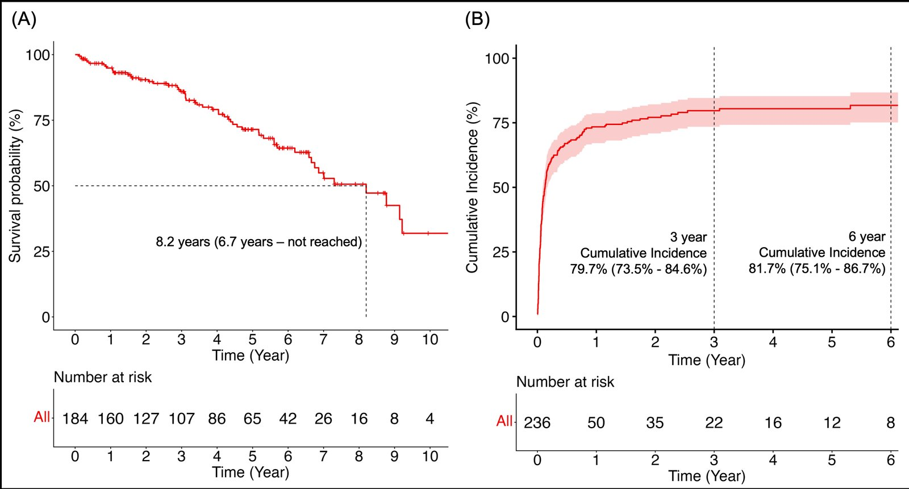
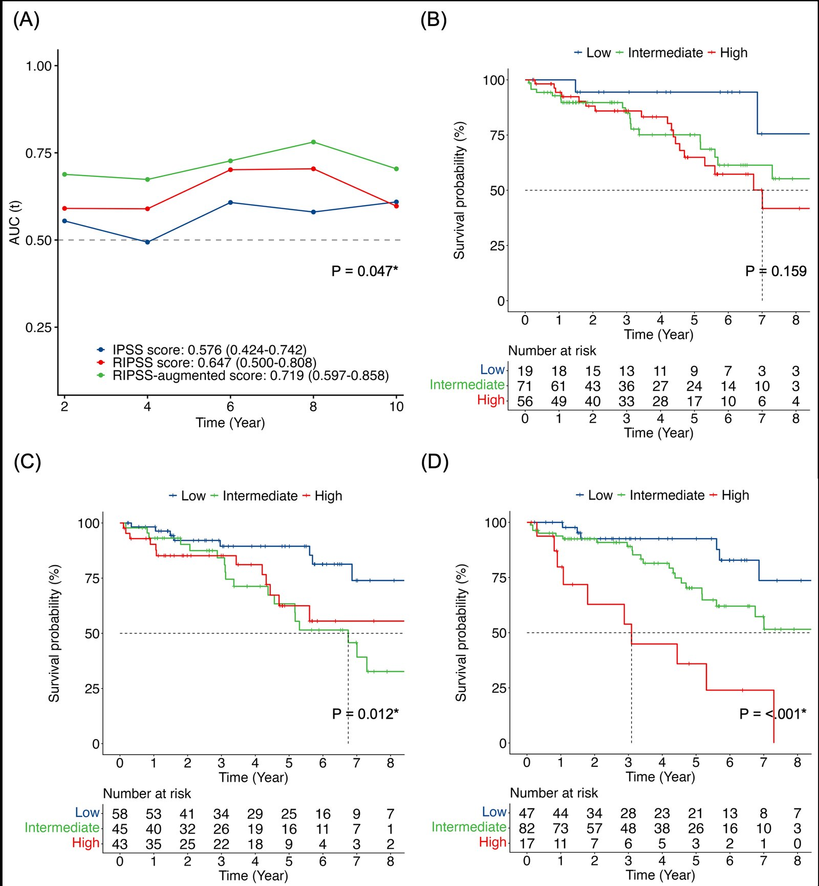

#### 개요

림프형질세포 림프종(lymphoplasmacytic lymphoma, LPL) / 발덴스트롬 마크로글로불린혈증(Waldenström macroglobulinemia, WM) 환자에서 기존 예후 점수인 **IPSS-WM**과 **rIPSS-WM**(revised IPSS-WM)의 전체 생존(overall survival, OS) 예측 성능을 비교하고, rIPSS-WM에 추가 예후 인자를 결합한 **RIPSS-augmented 점수**를 새로 개발한 단일 기관 후향적 코호트 연구입니다.

#### 데이터

- **출처**: 단일 기관 후향적 임상 데이터
- **코호트**: 신규 진단 WM/LPL 236명 중 1차 치료를 시작한 **184명** (중위 연령 64.0세, 남성 76.1%)
- **Index date**: 1차 치료 시작일 / **추적 기간 중앙값**: 5.0년 (reverse Kaplan-Meier)
- **결과 변수**: 전체 생존 (사망 55명, 29.9%)
- 모든 점수를 동일 집단에서 비교하기 위해 complete-case 분석 (146명)

*(A) 전체 코호트의 OS — 중앙 생존 8.2년. (B) 진단 후 1차 치료 시작의 누적 발생률 (사망을 경쟁 위험으로 처리) — 3년 79.7%, 6년 81.7%.*

#### 분석 방법

- **점수 재계산**: 공개된 기준에 따라 IPSS-WM(3군)·rIPSS-WM(5군)을 환자별로 재산출
- **점수 개발**: 단변량·다변량 Cox 회귀와 AIC 기반 stepwise selection으로 rIPSS-WM에 더할 독립 예후 인자를 선별하고, β 계수를 0.5점 단위로 스케일링해 0–4.5점 점수 체계 구성
- **가정 검정**: scaled Schoenfeld residual로 비례위험 가정 확인 (global P = .61)
- **성능 비교**: Harrell's C-index, time-dependent ROC 기반 **integrated AUC (iAUC)**, 부트스트랩 기반 일측 검정
- **내부 검증**: 부트스트랩 optimism correction (discrimination·calibration)
- **하위군·민감도 분석**: 1차 요법(bendamustine–rituximab vs 기타)별 분석, rIPSS-WM 5군 원 분류로 재분석

#### RIPSS-augmented 점수

| 항목 | 점수 |
|---|---|
| rIPSS-WM: very low / low / intermediate / high·very high | 0 / 1 / 1.5 / 2 |
| B 증상 (B symptoms) | 1 |
| 절대 호중구 수 (ANC) < 1,000/µL | 1.5 |

총점 0–4.5점 → **저위험(0–1) / 중간위험(1.5–2.5) / 고위험(≥3)**

다변량 모형에서 B 증상(HR 2.46, 95% CI 1.08–5.64)과 ANC < 1,000/µL(HR 4.56, 95% CI 1.77–11.76)이 rIPSS-WM과 독립적으로 짧은 OS와 연관되었습니다.

#### 결과

*(A) 세 점수의 time-dependent AUC. (B–D) IPSS-WM, rIPSS-WM, RIPSS-augmented 위험군별 Kaplan-Meier OS.*

| 점수 | iAUC (95% CI) | C-index | Log-rank P |
|---|---|---|---|
| IPSS-WM | 0.58 (0.42–0.74) | 0.55 | .16 |
| rIPSS-WM | 0.65 (0.50–0.81) | 0.61 | .01 |
| **RIPSS-augmented** | **0.72 (0.60–0.86)** | **0.67** | **< .001** |

- RIPSS-augmented가 가장 뚜렷한 생존 분리를 보임: 저위험 대비 중간위험 HR **2.50**, 고위험 HR **8.44** (사망률 12.8% → 28.0% → 58.8%)
- iAUC가 rIPSS-WM보다 유의하게 높았음 (P = .047), 2년 간격 landmark에서도 일관되게 최고 AUC
- 1차 요법 하위군(BR / 기타) 모두에서 생존을 유의하게 층화 (log-rank P < .001, P = .03)

#### 결론

기존 rIPSS-WM에 **B 증상과 호중구 감소증**이라는 일상 진료에서 쉽게 얻을 수 있는 두 변수를 더하는 것만으로 LPL/WM 환자의 생존 예측력을 개선할 수 있음을 보였습니다. 단일 기관·소규모 코호트에서 개발·평가되어 부트스트랩 검증상 calibration의 낙관 편향이 확인된 만큼, 독립 코호트에서의 외부 검증이 필요한 가설 생성 단계의 결과입니다.

#### 진행 상황

논문 작성 중 (Manuscript in Preparation).

> Suein Choi, Chaehyeon Lee, Sung-Soo Park, et al., "An Augmented Revised Prognostic Score for Overall Survival in Patients with Lymphoplasmacytic Lymphoma" (작성 중).
